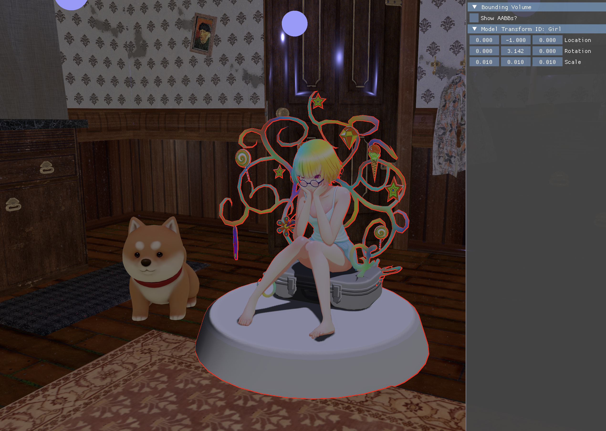
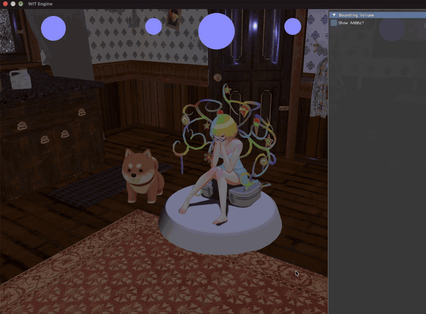

# Vulkan Engine

A hobby real-time renderer written in C++20 on top of Vulkan, running on macOS
through MoltenVK. Something fun I've been working on for almost a year now.



glTF scene with PBR shading, point lights, cubemap reflections, a skybox, among other features.

## Object Selection

Left-clicking an object in the viewport selects it. Each frame, a separate offscreen
pass draws every object into an `R32_UINT` image with its object ID as the color.
On click, the pixel under the cursor is copied back to a host-visible buffer and
read on the CPU, so the hit comes from the rasterized scene, not a ray cast.

- Clicking an unselected object adds it to the selection. Several objects can be
  selected at once.
- Clicking a selected object deselects it.
- Clicking empty space (ID `0`) clears the selection.
- Clicks that land on ImGui windows are ignored.

Each selected object gets a **Model Transform** panel in the sidebar with
location, rotation, and scale controls, which is how objects are moved in the
clip below. A screen-space outline around the selection *(in progress)* is drawn
by a full-screen pass that reads the same ID image.


## Bounding volumes

Toggling **Show AABBs?** draws the axis-aligned bounding box of every mesh in the
scene as a white wireframe, from the same buffer the acceleration structure is
built out of. The nested boxes are the individual meshes making up the model —
hair, glasses, the suitcase, each accessory — wrapped by the bounds of the whole.



This is the debug view for the GPU bounding volume hierarchy that's currently
being built out. Being able to see the boxes is what makes it possible to tell
whether the tree above them is right.

## Features

- **glTF loading** via fastgltf — meshes, materials, textures, node hierarchy
- **PBR shading** — Cook-Torrance specular with GGX distribution, Smith geometry,
  and Schlick fresnel, driven by glTF metallic/roughness maps
- **Point lights** with a dedicated billboard pass
- **Cubemap skybox** and environment reflections
- **Bindless textures** — a single descriptor array indexed per material
- **Object selection** through an offscreen ID pass, with multi-select and
  per-object transform editing (selection outline in progress)
- **4x MSAA** with resolve, using dynamic rendering rather than render passes
- **Dear ImGui** integration for runtime controls
- **GPU LBVH** *(in progress)* — morton codes, radix sort, radix tree
  construction, and bottom-up AABB propagation, following [Karras 2012](https://dl.acm.org/doi/epdf/10.5555/2383795.2383801)

## Future Features

- Simple Collision Detection, using BVH hierarchy
- Using differential geometry to glean geometric properties from [Keenan Crane's lectures](https://youtube.com/playlist?list=PL9_jI1bdZmz0hIrNCMQW1YmZysAiIYSSS)
- A basic ray tracing

## Works In Progress

- Sharpening the synchronization

## Building

Requires the Vulkan SDK, CMake, Ninja, and `glslang`. Local SDK paths live in
`envUnix.cmake`, which is gitignored — you'll need to create it.

```sh
git clone --recurse-submodules <repo>
./build.sh             # configure, SPIR-V, build, and launch 
```

`build.sh` runs the binary at the end, so it's a build-and-run script rather
than a build-only one. CMake compiles shaders with `glslangValidator` as part
of the build. Every `.vert`, `.frag`, and `.comp` file in `shaders/` is picked
up automatically, and editing an included `.glsl` file recompiles the shaders
that include it. The `.glb` models and `.mov` files are stored with Git LFS.

## Layout

| Path | Contents |
| --- | --- |
| `src/core/` | Engine core — `main`, `EngineApp` (main loop, frame orchestration, selection), and RAII wrappers for device, swapchain, renderers (main and offscreen ID), pipeline, buffer, descriptor, compute, window, game objects |
| `src/asset/` | glTF models and meshes, images, textures, PBR materials |
| `src/systems/` | Per-pass render systems on a shared `RenderSystem` base — simple, point light, cubemap, bbox, offscreen ID, outline |
| `src/bvh/` | GPU LBVH construction — nodes, primitives, tree build |
| `src/io/` | Camera and keyboard movement |
| `src/ui/` | Dear ImGui wrapper — sidebar, light and model transform panels |
| `src/util/` | Shader path list, aggregate headers, stb_image implementation |
| `shaders/` | GLSL sources and committed SPIR-V |
| `models/` | glTF scenes (Git LFS) |
| `images/` | Cubemap faces and README media |
| `lib/` | Vendored dependencies — SDL, fastgltf, imgui, VMA, stb_image |

## Dependencies

SDL3, fastgltf, and Dear ImGui are git submodules. VMA, stb_image, and GLM are
vendored directly under `lib/`.

## Notes/Credits

Credit to these tutorials for their great help throughout my struggles:

- [Vulkan Game Engine Tutorial by Brendan Gaela](https://www.youtube.com/watch?v=Y9U9IE0gVHA&list=PL8327DO66nu9qYVKLDmdLW_84-yE4auCR)
- [OGLDEV](https://www.youtube.com/@OGLDEV)
- [Vulkan Tutorial](https://vulkan-tutorial.com/)
- [VkGuide](https://vkguide.dev/)
- [Learn OpenGL](https://learnopengl.com/)

Models used:

- [Just a girl](https://sketchfab.com/3d-models/just-a-girlb2359160a4f54e76b5ae427a55d9594d)
- [Shiba](https://sketchfab.com/3d-models/shiba-faef9fe5ace445e7b2989d1c1ece361c)
- [Kasumizawa Miyu](https://sketchfab.com/3d-models/blue-archivekasumizawa-miyu-108d81dfd5a44dab92e4dccf0cc51a02)

## AI Usage in Project

Claude was used to generate code for non-graphics code matters like this markdown or
the CMake compilation files, but all C++ and shader code was done by hand (aside from one exception, SetBufferPipelineBarrier  - denoted in function definition). Was also used for reference to answer questions.
